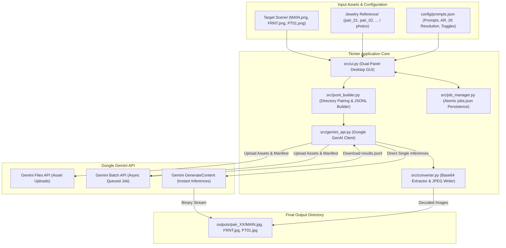

# 💎 Gemini E-Commerce Image Batch Generator

A high-performance desktop tool built with **Python & Tkinter** to automate studio-grade product photography and lifestyle imagery for e-commerce listings (specifically Amazon jewelry catalogs) at scale using Google's **Gemini Multimodal Image Generation APIs** (`gemini-3-pro-image-preview` and `gemini-3.1-flash-image-preview`).

---

## 📌 Table of Contents

- [Overview](#-overview)
- [The Problem It Solves](#-the-problem-it-solves)
- [System Architecture](#-system-architecture)
- [Key Features](#-key-features)
- [Folder Structure](#-folder-structure)
- [Getting Started](#-getting-started)
  - [Prerequisites](#prerequisites)
  - [Installation](#installation)
  - [Launching the App](#launching-the-app)
- [Workflow & Usage Guide](#-workflow--usage-guide)
  - [1. Prepare Assets](#1-prepare-assets)
  - [2. Configure Scene Prompts](#2-configure-scene-prompts)
  - [3. Run the Job (Batch vs. Instant)](#3-run-the-job-batch-vs-instant)
  - [4. Dashboard & Results Extraction](#4-dashboard--results-extraction)
- [Configuration Reference (`config/prompts.json`)](#-configuration-reference-configpromptsjson)
- [Safety & Cost Guardrails](#-safety--cost-guardrails)
- [Technical Architecture](#-technical-architecture)

---

## 🔍 Overview

Creating standard Amazon listing image sets for dozens or hundreds of jewelry SKUs is traditionally time-consuming and expensive. This tool automates the entire asset preparation and generation cycle:

- **MAIN (Pure White Background)**: Isolates the raw jewelry piece, applies photorealistic 22k yellow gold metallic sheen and studio reflections, and outputs a compliant pure-white-background hero shot.
- **FRNT (Aesthetic Editorial / Front)**: Places the jewelry in an upscale minimalist scene with curated warm lighting and studio tones (e.g., `#F8E5CB` beige).
- **PT01 / Lifestyle (Contextual Mockup Swap)**: Takes a lifestyle template (model wearing a pendant, ruler comparison, display box) and intelligently replaces *only* the engraved motif/pendant with the physical reference piece while preserving lighting, chain, and background intact.

---

## ⚡ The Problem It Solves

| Image Type | Traditional Approach | Gemini Batch Generator |
| :--- | :--- | :--- |
| **Hero Shot (`MAIN`)** | Hours of manual pen-tool clipping & shadow drafting in Photoshop. | Automated single-shot generation to pure `#FFFFFF` background with natural contact shadow. |
| **Lifestyle Swap (`PT01`)** | Expensive 3D modeling or repeat studio photoshoots. | Multi-modal inpainting prompt that swaps design motifs onto pre-approved lifestyle scenes. |
| **Catalog Scalability** | Manual repetitive edits for each SKU. | Automated folder pairing and bulk queueing across 40+ products simultaneously. |

---

## 🏗 System Architecture



---

## ✨ Key Features

- **Dual Execution Modes**:
  - **Batch API (Async / Bulk)**: Submits all requests to Google's Batch API for economical, high-throughput asynchronous generation without keeping your local machine locked.
  - **Instant (Sync)**: Sequential synchronous generation via `generate_content` for fast spot-checking and test runs.
- **Smart Directory Pairing & Resume Support**:
  - Automatically matches target scenes with product reference folders.
  - **Idempotency**: Skips any product-scene combinations that have already been generated in `outputs/`, preventing duplicate API billing.
- **Heuristic Image Prioritization**:
  - Automatically ranks and picks the best reference photo within each product folder (prioritizing `main`, `hero`, or `1.*` filenames).
- **Flexible Scene-Level Configuration**:
  - Set custom prompts, aspect ratios (`1:1`, `3:4`, `16:9`), and resolutions (standard vs. **2K** up to `2048x2048`) per scene.
  - **Target Scene Bypass (`skip_target_scene`)**: Toggle between sending the target scene image as visual context or generating purely from reference photos.
- **Cost Safety Guardrails**:
  - Built-in **Dry Run Mode** enabled by default.
  - Dual confirmation safety lock (Paid checkbox + manual typed `SUBMIT` confirmation) to prevent accidental charges.
- **Crash-Resilient State Tracking**:
  - Uses atomic file swaps (`.tmp` → `.bak` → `jobs.json`) to prevent database corruption during network drops or app terminations.

---

## 📁 Folder Structure

```
Ecom img project/
├── config/
│   └── prompts.json          # Per-scene prompt mappings, aspect ratio, resolution & flags
├── data/
│   ├── jobs.json             # Persistent batch job tracking database
│   └── results_*.jsonl       # Downloaded raw batch output payloads
├── src/
│   ├── main.py               # Main application entry point
│   ├── ui.py                 # Tkinter GUI (control panel, prompt modal, jobs dashboard)
│   ├── gemini_api.py         # Google GenAI SDK wrapper (batches, uploads, polling)
│   ├── jsonl_builder.py      # Folder pairing logic and JSONL line generator
│   ├── converter.py          # Decodes Gemini JSONL responses into JPGs
│   └── job_manager.py        # Atomic read/write operations for jobs.json
├── Target Scene/             # Base template images (MAIN.png, FRNT.png, PT01.png)
├── Jewelry Reference/        # Product SKU folders (pair_01/, pair_02/, etc.)
├── outputs/                  # Final generated images organized by SKU folder
└── requirements.txt          # Python dependencies
```

---

## 🚀 Getting Started

### Prerequisites

- **Python 3.10+**
- A **Google Gemini API Key** with access to multimodal image generation models.

### Installation

1. **Clone the repository:**
   ```bash
   git clone https://github.com/gameway-sn/Amazon_Img.git
   cd "Amazon_Img"
   ```

2. **Create and activate a virtual environment:**
   ```bash
   # Using conda
   conda create -n gemini-ecom python=3.10 -y
   conda activate gemini-ecom

   # Or using venv
   python -m venv venv
   # Windows:
   .\venv\Scripts\activate
   # macOS/Linux:
   source venv/bin/activate
   ```

3. **Install dependencies:**
   ```bash
   pip install -r requirements.txt
   ```

### Launching the App

```bash
python src/main.py
```

---

## 🔄 Workflow & Usage Guide

### 1. Prepare Assets
- Place your base template images in `Target Scene/`:
  - `MAIN.png` (Used for pure white background listing shot)
  - `FRNT.png` (Used for front lifestyle/editorial shot)
  - `PT01.png` (Used for lifestyle or dimensional mockup)
- Place product photos inside subfolders within `Jewelry Reference/`:
  ```
  Jewelry Reference/
  ├── pair_01/
  │   └── photo_01.jpg
  ├── pair_02/
  │   └── main.jpg
  ```

### 2. Configure Scene Prompts
Click **Configure Prompts** in the UI to open the per-scene configuration dialog:
- Write or edit the prompt for each scene.
- Select the **Aspect Ratio** (`1:1`, `3:4`, `16:9`) and **Resolution** (e.g. `2048x2048` for 2K).
- Check **Deselect Target Scene** for prompts like `MAIN` and `FRNT` where you want the model to generate the image purely from the reference photo without conditioning on a background image.

### 3. Run the Job (Batch vs. Instant)
- Choose your **Image Model** (`gemini-3-pro-image-preview` or `gemini-3.1-flash-image-preview`).
- Select your execution mode:
  - **Batch API (Async)**: Recommended for large production runs.
  - **Instant (Sync)**: Recommended for testing a few items immediately.
- Unlock the run button:
  1. Check **Enable LIVE Mode** (leave unchecked for Dry Run simulation).
  2. Check **I understand this is a PAID operation**.
  3. Type `SUBMIT` into the confirmation field.
  4. Click **Create Batch Run** or **Start Instant Run**.

### 4. Dashboard & Results Extraction
For Batch API jobs, use the **Jobs Dashboard** on the right panel:
1. **Status**: Check if the job is `PENDING`, `RUNNING`, or `SUCCEEDED`.
2. **Download**: Once `SUCCEEDED`, click to pull down `data/results_<run_id>.jsonl`.
3. **Convert**: Automatically decodes base64 image strings and writes formatted `.jpg` files directly into `outputs/<product_folder>/<scene>.jpg`.
4. **Folder**: Opens the output directory in your native file explorer.

---

## ⚙ Configuration Reference (`config/prompts.json`)

The `config/prompts.json` file controls model instructions and output geometry for each scene name:

```json
{
    "MAIN": {
        "prompt": "Professional product photography edit of the gold pendant from the image. Place the pendant centered on a pure, seamless white background. Transform the surface material to rich, polished 22k yellow gold with realistic metallic sheen and warm studio highlights. Include a soft contact shadow underneath the pendant and a faint, transparent, blurred mirror reflection on the white floor surface. High resolution, crisp macro focus, commercial jewelry aesthetic.",
        "aspect_ratio": "1:1",
        "resolution": "2048x2048",
        "skip_target_scene": true
    },
    "FRNT": {
        "prompt": "Place it on a minimalist beige background professional photography with proper lighting #F8E5CB",
        "aspect_ratio": "1:1",
        "resolution": "2048x2048",
        "skip_target_scene": true
    },
    "PT01": {
        "prompt": "Replace only the engraved motif on the round pendant in the target scene with the engraved motif from the reference jewelry pendant. Keep the pendant's shape, size, position, gold finish, rim, loop and lighting exactly the same. Do not change anything else in the image.",
        "aspect_ratio": "1:1",
        "resolution": "2048x2048",
        "skip_target_scene": false
    }
}
```

---

## 🛡 Safety & Cost Guardrails

- **Dry-Run by Default**: Unless explicitly activated, API requests run in mock mode to verify pair logic, file paths, and syntax without incurring charges.
- **Explicit Unlock Requirement**: To prevent accidental clicks, the submission button is disabled until both the acknowledgment checkbox is checked and `SUBMIT` is explicitly typed.
- **Idempotent Builds**: Existing output images in `outputs/` are skipped automatically so users don't pay twice for already-completed items.
- **Upload Caching**: Assets are hashed and cached during batch generation, preventing redundant uploads of the same target scene image across dozens of jobs.

---

## 🏛 Technical Architecture

- **GUI Framework**: Python `tkinter` & `ttk` with asynchronous worker threads (`threading.Thread`) to keep the interface completely responsive during network operations.
- **Gemini SDK**: Uses the modern Google GenAI SDK (`google-genai` / `genai.Client`) supporting both `client.batches` and `client.models.generate_content`.
- **Atomic File Management**: Implements double-buffering writes via temporary files and backups to guarantee `jobs.json` integrity.
